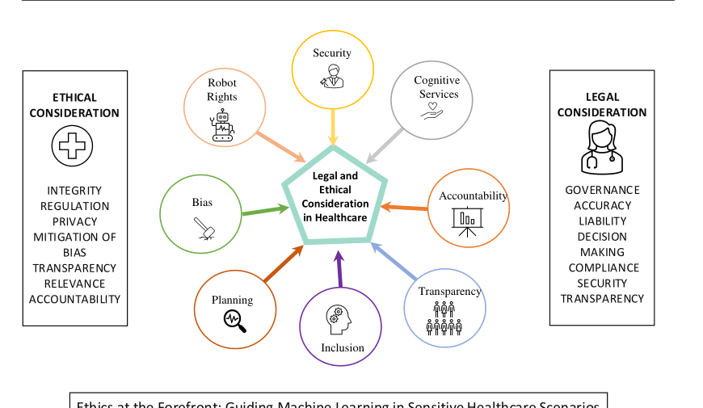

# Ethical-Healthcare-ML

A published discussion of ethical frameworks for machine learning on sensitive healthcare data.

[](https://doi.org/10.1109/access.2023.3340884)
[](https://github.com/haseebjaved123/EthicalML_Access_2024)



## What it is

A published discussion of ethical frameworks for machine learning on sensitive healthcare data. Venue: IEEE Access, vol. 12, pp. 16233–16254, 2024.

## Why it matters

The paper is part of the published record on applied machine learning. This repository records the bibliographic facts and the figure used on the project site. It does not add unpublished measurements.

## Citation

```bibtex
@article{javed2024ethical,
  title={Ethical Frameworks for Machine Learning in Sensitive Healthcare Applications},
  author={Javed, Haseeb and Muqeet, Hafiz Abdul and Javed, T. and Rehman, A. and Sadiq, R.},
  journal={IEEE Access},
  year={2024},
  doi={10.1109/access.2023.3340884}
}
```

## License

MIT for notes and helper code in this repository. The article remains with its publisher.
